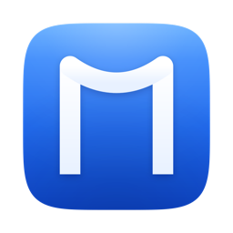
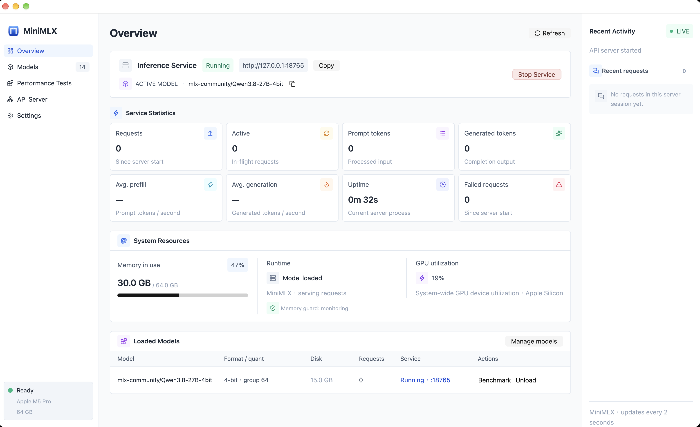

<div align="center">
  
  <h1>MiniMLX</h1>
  <p><strong>更快运行模型，操作依然简单。</strong><br />
  在 Mac 上轻松运行你喜欢的 AI 模型。</p>
  <p>
    
    
    
    
  </p>
  <p>
    <a href="#安装">安装</a> ·
    <a href="#精选模型">精选模型</a> ·
    <a href="#功能">功能</a> ·
    <a href="#快速开始">快速开始</a> ·
    <a href="#连接你的应用">连接你的应用</a> ·
    <a href="#许可证">许可证</a>
  </p>
  <p><a href="README.md">English</a> · <strong>简体中文</strong></p>
</div>

---

<p align="center">
  
</p>

运行强大的模型，不必经历复杂的配置。MiniMLX 将模型下载、本地推理和 API 服务整合到一个原生 Mac 应用中。选择模型，启动服务，就可以开始使用。

## 精选模型

MiniMLX 支持 Hugging Face 上广泛的主流 MLX 格式模型，包括 Qwen 和 Llama。你可以在应用中发现新模型，也可以添加已有模型；从日常使用的小模型到更复杂的选择，都可以在同一个模型库中管理。

我们特别关注 **Qwen3.8 Flash Next** 和 **Qwen3.8 27B** 在 Mac 上的使用体验。这两个模型都可以在 MiniMLX 中搜索和管理，兼容配置下的 Flash Next 还可以使用 MTP 加速。如果你想找一个模型开始体验，可以搜索：

- `mlx-community/Qwen3.8-Flash-Next-4bit-mtp`
- `mlx-community/Qwen3.8-27B-4bit`

它们只是可探索模型中的两个例子。兼容性、内存需求和性能取决于具体模型及你的 Mac；较大的模型可能需要更多内存和磁盘空间。

## 功能

### 发现你的下一个模型

直接在 MiniMLX 中搜索 **Hugging Face** 和 **ModelScope**。查看模型详情、下载需要的模型，并在一个地方管理你的收藏，无需在文件夹和终端命令之间来回切换。

Mac 上已经有模型？添加现有模型目录，即可与通过 MiniMLX 下载的模型一起管理。你可以暂停和继续下载、查看模型信息，以及加载或卸载模型。

### 为 Mac 而设计

MiniMLX 为 Apple Silicon 构建，采用原生 macOS 应用体验。加载支持的模型时，它会考虑当前可用内存，让你少花时间研究如何装下模型，多花时间使用模型。

你可以在模型设置中调整适用于自己设备和工作负载的选项。对于某些无法完整放入可用内存的大模型，MiniMLX 也提供运行方式；支持范围和速度因模型及硬件而异。

### 在需要时获得更快的速度

对于兼容模型，可以使用 MTP 等加速功能，充分发挥 Apple Silicon 的能力。你也可以调整支持的性能设置，找到适合自己 Mac 的平衡。

使用内置性能测试，查看不同上下文长度下的提示词处理速度、生成速度、延迟和内存占用。测试结果可保留为历史记录，并支持导出，方便后续比较。

### 让本地模型服务你的应用

点击即可启动本地推理服务，连接支持 **OpenAI 兼容 API** 的应用。MiniMLX 会显示服务地址，并提供复制客户端实际使用的模型名称的功能。

无论是聊天、编程，还是自己的项目，都可以通过熟悉的界面管理本地模型和服务。服务地址、端口和可选的身份验证均可在设置中调整。

### 一切尽在眼前

在概览页面查看当前模型、服务状态、请求、Token 吞吐量、内存和 GPU 活动。需要更多信息时，可以直接查看模型详情或运行性能测试。

通过 macOS 菜单栏随时管理 MiniMLX：显示或隐藏主窗口、查看服务状态，以及启动或停止服务。你也可以选择启动应用时是否显示窗口。

## 安装

### macOS 应用

从 [GitHub Releases](https://github.com/shijizhi/MiniMLX/releases) 下载 Apple Silicon 版本的 DMG。打开 DMG，将 **MiniMLX** 拖入**应用程序**文件夹，然后启动应用。

发布的 DMG 已使用 Developer ID 签名并通过 Apple 公证。模型需要单独下载。

**系统要求：**搭载 Apple Silicon 的 Mac。可运行的模型取决于可用内存、磁盘空间和所选模型。最低支持的 macOS 版本尚未确定。

## 快速开始

1. 从应用程序文件夹打开 **MiniMLX**。
2. 在**模型**页面搜索兼容模型，或添加 Mac 上已有的模型。
3. 下载并加载模型，然后启动推理服务。启动服务时，MiniMLX 也可以提示你选择模型。
4. 将应用连接到本地 API，并使用从 MiniMLX 复制的模型名称。

完成后，你可以随时在 MiniMLX 中查看模型、服务和性能信息。

## 连接你的应用

OpenAI 兼容客户端的默认 API 地址为：

```text
http://127.0.0.1:18765/v1
```

使用从 MiniMLX 复制的 API 模型名称，或者查看服务暴露的模型：

```bash
curl http://127.0.0.1:18765/v1/models
```

发送聊天请求时，将下面的 `YOUR_MODEL_ID` 替换为 MiniMLX 中显示的模型名称：

```bash
curl http://127.0.0.1:18765/v1/chat/completions \
  -H 'Content-Type: application/json' \
  -d '{
    "model": "YOUR_MODEL_ID",
    "messages": [{"role": "user", "content": "Hello!"}],
    "max_tokens": 128
  }'
```

如果启用了 API 身份验证，请使用 Bearer token 提供配置的密钥。监听地址和端口可以在设置中修改。

## 许可证

MiniMLX 基于 [Apache License 2.0](LICENSE) 开源。第三方声明请参阅 [NOTICE](NOTICE)。
